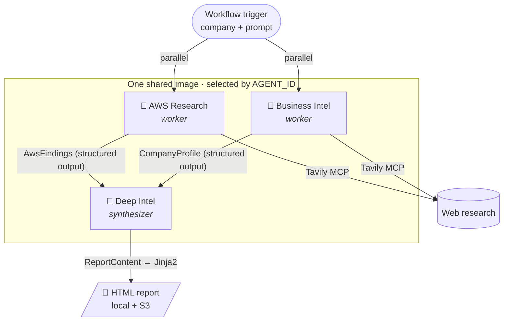
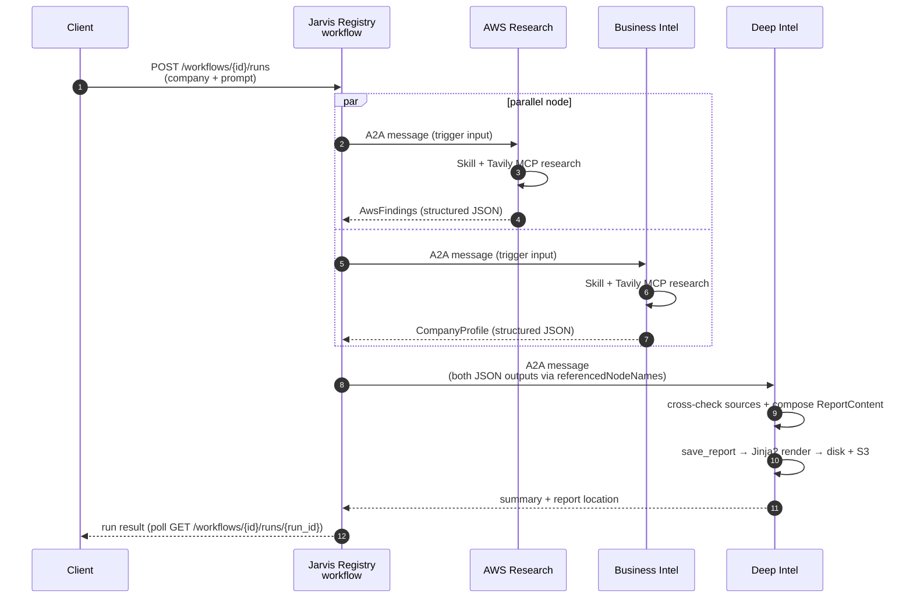

<div align="center">

# 🔍 AWS Customer Intelligence Orchestrator

**Multi-agent research system that turns a company domain into an AWS sales-opportunity report.**

[](https://www.python.org/)
[](https://strandsagents.com)
[](https://a2a-protocol.org)
[](https://aws.amazon.com/bedrock/agentcore/)
[](https://docs.docker.com/compose/)

*Three specialized A2A agents · one shared container image · orchestrated by a Jarvis Registry workflow*

</div>

---

## 📖 Overview

Give it a prompt like `"Analyze atscale.com for AWS opportunities"` and it produces a polished HTML customer-intelligence report — executive summary, company snapshot, AWS opportunities mapped to business challenges, and strategic recommendations — saved locally and optionally uploaded to S3 (presigned URL).

Under the hood there are three independent [A2A protocol](https://a2a-protocol.org) agents — two research specialists and a report synthesizer — but **this repo contains no orchestration code**: fanning out to the two specialists in parallel and feeding their outputs to the synthesizer is owned by a **Jarvis Registry workflow**, authored outside this repo. Every agent runs on [Amazon Bedrock](https://aws.amazon.com/bedrock/) and is served with [`bedrock-agentcore`](https://pypi.org/project/bedrock-agentcore/)'s A2A runtime — the same binary runs locally under Docker Compose or in the cloud as AgentCore Runtimes.



*The trigger → parallel fan-out → join shown above is a Jarvis Registry workflow definition (authored in the registry portal), not Python in this repo — see [How It Works](#️-how-it-works).*

## ✨ Key Features

- **🐳 One image, three agents** — every container runs the same code; the `AGENT_ID` env var (`deep_intel` | `aws_research` | `business_intel`) decides which agent a process becomes at boot.
- **🔗 A2A-native** — each agent is an independent [A2A](https://a2a-protocol.org) service with an agent card, served via `bedrock_agentcore.runtime.serve_a2a` (AgentCore contract: port 9000 at `/`, `/ping` health, card at `/.well-known/agent-card.json`).
- **⚡ Parallelism owned by the workflow, not Python** — a Jarvis Registry workflow's `parallel` node fans the trigger input out to both research agents simultaneously; this repo has no inter-agent client code.
- **🧾 Schema-enforced output** — workers produce their typed contracts (`AwsFindings`, `CompanyProfile`) via Strands **structured output**: enforced by the provider at decode time, never parsed out of prose.
- **🖨️ Deterministic HTML** — the LLM composes only typed `ReportContent`; a Jinja2 template owns all markup/CSS. Reports are always valid, consistent, and injection-safe (autoescaped).
- **🗂️ Registry-driven capability** — every agent's skills, output schema, and MCP servers are declared in one place (`agents/registry.py`). Adding a capability is a data change, not a new service class.
- **📚 Skills as Markdown** — research methodology lives in `agents/skills/*/SKILL.md`, loaded on demand via progressive disclosure. Edit worker behavior without touching Python.
- **☁️ IaC included** — CDK stacks deploy the three agents as independent AgentCore Runtimes with per-agent IAM roles; CI (`.github/workflows/ci-ecr.yml`) builds, pushes, and deploys end-to-end.

## 🚀 Quick Start

### Prerequisites

- Python **3.10+** (containers use 3.12) and [`uv`](https://docs.astral.sh/uv/)
- AWS credentials with **Bedrock** access
- A **Tavily MCP** endpoint URL (web research for the workers)

### Installation

```bash
git clone <this-repo> && cd jarvis-strands-github-mcp
uv sync
```

### Configuration

Create a `.env` file:

```bash
# Web research (required — workers call Tavily via MCP)
TAVILY_MCP_URL=https://your-tavily-mcp-endpoint
TAVILY_MCP_TOKEN=your_token            # optional, if the endpoint needs auth

# Bedrock model (required — no default). If your org gates Bedrock behind
# application inference profiles, use the profile ARN here.
MODEL=us.anthropic.claude-sonnet-5

# AWS credentials (or use a profile / instance role)
AWS_ACCESS_KEY_ID=...
AWS_SECRET_ACCESS_KEY=...
AWS_REGION=us-east-1

# Reporting (optional)
S3_BUCKET=your-reports-bucket
```

<details>
<summary><b>📋 Full environment variable reference</b></summary>

| Variable | Required | Default | Description |
|----------|:--------:|---------|-------------|
| `AGENT_ID` | ✅ | — | Agent this process serves: `deep_intel` \| `aws_research` \| `business_intel` |
| `TAVILY_MCP_URL` | ✅ | — | Tavily MCP server URL |
| `MODEL` | ✅ | — | Bedrock model id, inference-profile ARN, or application-inference-profile ARN |
| `TAVILY_MCP_TOKEN` | ❌ | — | Auth token for the Tavily MCP endpoint |
| `TAVILY_MCP_AUTH_HEADER` | ❌ | `Authorization` | Header name for the MCP token |
| `TAVILY_MCP_AUTH_PREFIX` | ❌ | `Bearer ` | Prefix prepended to the MCP token |
| `TAVILY_MCP_TRANSPORT` | ❌ | `streamable_http` | MCP transport |
| `AWS_REGION` | ❌ | `us-east-1` | AWS region for Bedrock / S3 |
| `MAX_TOKENS` | ❌ | `8192` | Max tokens per model call |
| `BEDROCK_READ_TIMEOUT` | ❌ | `300` | Bedrock read timeout (s) |
| `BEDROCK_CONNECT_TIMEOUT` | ❌ | `30` | Bedrock connect timeout (s) |
| `BEDROCK_MAX_ATTEMPTS` | ❌ | `3` | Bedrock retry attempts |
| `REPORT_OUTPUT_DIR` | ❌ | `reports` | Local output directory |
| `S3_BUCKET` | ❌ | — | Enables S3 upload when set |
| `S3_PREFIX` | ❌ | `aws-intel-reports` | S3 key prefix |
| `S3_PRESIGNED_URL_EXPIRY` | ❌ | `86400` | Seconds the report's presigned URL stays valid (bucket stays private; no public read needed) |
| `ORCHESTRATOR_LOG_LEVEL` | ❌ | `INFO` | `DEBUG` surfaces tool inputs/results |
| `ORCHESTRATOR_LOG_FILE` | ❌ | `orchestrator.log` | Log file path |
| `PORT` | ❌ | `9000` | Local port override |
| `AGENT_BASE_URL` | ⚠️ | `http://localhost:<PORT>` | URL used to reach this agent — advertised in the agent card (the Jarvis Registry workflow resolves agents through the registry's own proxy, not this directly, but AgentCore still needs a card URL). Set per-service (compose does this); never set globally |
| `A2A_BEARER_TOKEN` | ❌ | — | Static bearer token used as a fallback for the Tavily MCP client's auth (highest precedence) |
| `A2A_TOKEN_SECRET_ARN` | ❌ | — | Secrets Manager secret (per agent, e.g. `agentcore/deep_intel`) holding the Entra ID token (raw or `{"token": ...}`), TTL-cached ~5 min — same Tavily MCP auth fallback |

</details>

### Run all three agents

```bash
docker compose up --build
```

| Service | Host port | `AGENT_ID` |
|---------|-----------|------------|
| Deep Intel (synthesizer) | `9001` | `deep_intel` |
| AWS Research | `9002` | `aws_research` |
| Business Intel | `9003` | `business_intel` |

### Send a request

Each agent is a standalone A2A/JSON-RPC service — no SDK required to talk to one directly, e.g. to smoke-test a worker:

```bash
curl -s -X POST http://localhost:9002/ \
  -H "Content-Type: application/json" \
  -d '{
    "jsonrpc": "2.0",
    "id": "1",
    "method": "message/send",
    "params": {
      "message": {
        "kind": "message",
        "messageId": "'"$(uuidgen)"'",
        "role": "user",
        "parts": [{"kind": "text", "text": "Analyze stripe.com for AWS opportunities"}]
      }
    }
  }'
```

But the end-to-end report flow — fan out to both workers, then synthesize — is driven by a **Jarvis Registry workflow** (`POST /api/v1/workflows/{id}/runs`), not by calling one of these agents directly. See [How It Works](#️-how-it-works).

<details>
<summary><b>Run a single agent without Docker</b></summary>

```bash
AGENT_ID=aws_research PORT=9002 uv run python -m agents.server
```

Health: `GET /ping` · Agent card: `GET /.well-known/agent-card.json`

</details>

## 🏗️ How It Works



1. A workflow run is triggered with the company + prompt as `initialInput`. The workflow's `parallel` node sends that same input to both workers simultaneously — no node-to-node choreography needed, since neither worker depends on the other.
2. **Workers** research using the Tavily MCP tools, guided by their Skill; their final answer is produced via structured output, so the returned artifact is schema-valid JSON *by construction*.
3. The workflow's next node (**Deep Intel**) declares both workers as `referencedNodeNames`, so their JSON lands in its prompt automatically. Deep Intel cross-checks the sources, composes typed `ReportContent` (content only — no markup), and its `save_report` tool renders the HTML through the Jinja2 template and persists it (disk + presigned S3 URL).

### Design decisions worth knowing

- **No agent in this repo calls another one.** The parallel fan-out and the join that feeds both workers' output to Deep Intel live entirely in a Jarvis Registry workflow definition (authored in the registry portal), not in Python here. This repo only has to get each agent's A2A contract right in isolation.
- **A2A clients send messages to `card.url`**, not to the endpoint you configure (that's only used to fetch the card). Each agent advertises the address it's reachable at (`AGENT_BASE_URL`; AgentCore overwrites it with the real runtime URL when deployed) — this is what the Jarvis workflow's A2A executor resolves against.
- **No agent here streams.** Every agent runs in A2A legacy (single-artifact) mode: each is a workflow node now, not a client watching live narration, so the artifact must be exactly the agent's final answer.
- **Per-conversation isolation.** `StrandsA2AExecutor` builds a fresh agent per A2A `context_id` (LRU-cached); the expensive Tavily MCP client is started once per process and shared.

## 📂 Project Structure

<details>
<summary><b>Expand</b></summary>

```
Dockerfile                       # Single image for all agents
docker-compose.yml               # Three agent services (host ports 9001-9003)
agents/
├── server.py                    # Entrypoint: AGENT_ID → registry spec → serve_a2a (port 9000)
├── registry.py                  # ⭐ Source of truth: agent specs, schemas, skills, MCP servers
├── deep_intel/
│   ├── orchestrator.py          # Synthesizer agent: save_report tool only (no inter-agent calls)
│   └── reporting.py             # Jinja2 rendering, disk storage, optional S3 upload
├── skills/                      # Worker methodologies (progressive-disclosure Skills)
│   ├── aws-opportunity-research/SKILL.md
│   └── company-intelligence/SKILL.md
└── shared/
    ├── research_agent.py        # Unified worker engine (skill + schema + role line)
    ├── schemas.py               # Typed contracts: AwsFindings, CompanyProfile, ReportContent
    ├── bedrock.py               # BedrockModel + timeout/retry construction
    ├── templates/report.html.j2 # Report layout/CSS (the LLM never writes markup)
    ├── mcp/                     # MCP client builders (Tavily via streamable HTTP)
    └── core/                    # Config (fail-fast), logging, exceptions
cdk/                             # AgentCore Runtime deployment (see cdk/README.md)
test/                            # Contract + renderer + tool-path tests
reports/                         # Generated HTML reports (bind-mounted)
```

</details>

## ☁️ Deployment (Amazon Bedrock AgentCore)

The [`cdk/`](cdk/) app deploys the three agents as **independent AgentCore Runtimes** on the A2A protocol — one shared ECR image, one runtime per `AGENT_ID`, with no InvokeAgentRuntime wiring between them (nothing here calls another one of these agents):

```bash
cdk deploy JarvisAgentsBase        # ECR repo + reports S3 bucket, once
```

Everything after that runs as one CI pipeline (`.github/workflows/ci-ecr.yml`, `workflow_dispatch`): build & push the image, then `cdk deploy JarvisAgentsRuntime -c env=<dev|prod> -c imageTag=<git-sha>`. Inbound auth supports a **custom JWT authorizer** (e.g. Microsoft Entra) via `config.toml`, falling back to IAM SigV4. See [`cdk/README.md`](cdk/README.md).

The parallel fan-out / join that turns these three runtimes into one report pipeline is a **Jarvis Registry workflow**, authored separately in the registry portal — not part of this repo's deploy.

## 🧪 Testing

```bash
uv run pytest
```

Covers the report renderer (valid HTML, autoescaping, optional sections), `save_report` through the real Strands tool-invocation path, and outbound bearer-token resolution (`agents/shared/auth.py`, used by the Tavily MCP client).

## 🗺️ Roadmap

- [x] **Orchestration moved to a Jarvis Registry workflow** — removed the in-repo `asyncio.gather` fan-out and inter-agent A2A client; Deep Intel is synthesis-only now
- [x] **Automated CI deploy** — `.github/workflows/ci-ecr.yml` runs `cdk deploy` after every image push, not just the build/push step
- [ ] **Machine OAuth (client-credentials)** — replace the manually-rotated static Tavily MCP token
- [ ] **Secrets hygiene** — move `TAVILY_MCP_TOKEN` to AWS Secrets Manager
- [ ] **Tool-error observability** — WARNING-level hook for failed tool calls
- [ ] **Persistent task store** — tasks are in-memory today and don't survive restarts

## 🙌 Acknowledgments

Built on the [Strands Agents SDK](https://strandsagents.com), the [A2A protocol](https://a2a-protocol.org), [Amazon Bedrock AgentCore](https://aws.amazon.com/bedrock/agentcore/), and [Tavily](https://tavily.com) web research via [MCP](https://modelcontextprotocol.io).

## 📜 License

License to be determined.
